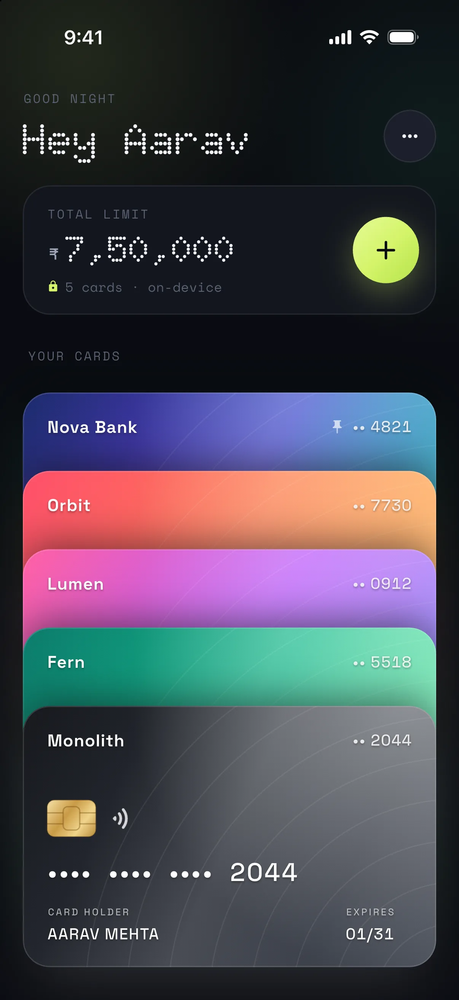
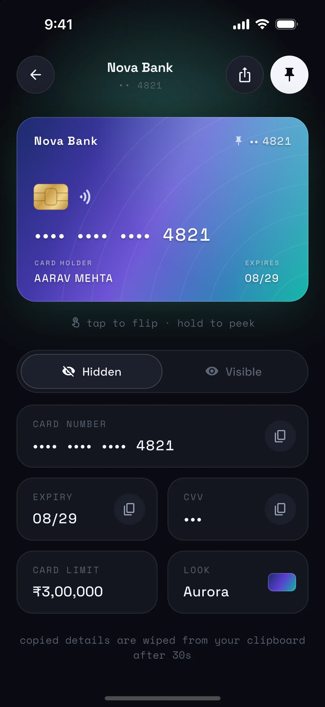
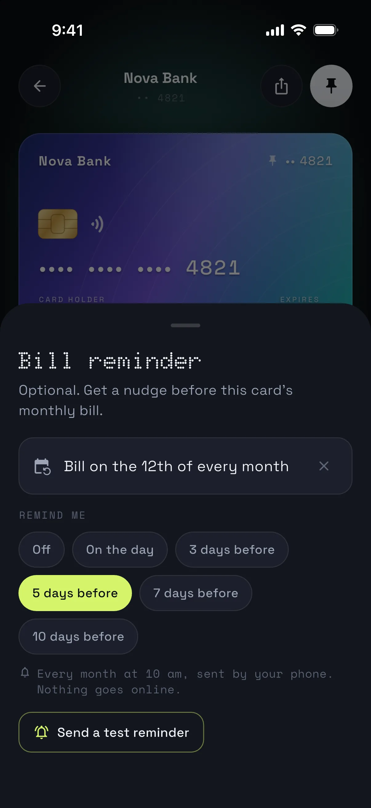

# PocketCards

Your private, offline wallet for credit-card details and bill reminders.

[Visit the website](https://pocketcards.domslittlestudio.cloud/)

PocketCards keeps the cards you choose to add on your phone. There are no accounts, cloud sync, or tracking.

## What it does

- Stores card details in encrypted, on-device storage guarded by Face ID, fingerprint, or device PIN.
- Masks card numbers by default and clears copied sensitive details from the clipboard after 30 seconds.
- Adds cards manually or scans supported cards over NFC when the phone supports it.
- Schedules optional monthly bill reminders as local phone notifications.
- Lets you personalize cards with built-in skins or one of your photos.
- Shares a card image with its number and CVV hidden by default.
- Creates and restores password-protected `.pcbackup` wallet backups.

## App previews

All screenshots use the app's fictional demo data.

| Wallet | Card details | Bill reminder |
| --- | --- | --- |
|  |  |  |

## License

The original app and website source code is available under the [MIT License](LICENSE).
Bundled fonts use their included SIL Open Font Licenses. Third-party logos,
trademarks, and artwork are subject to their respective rights.
